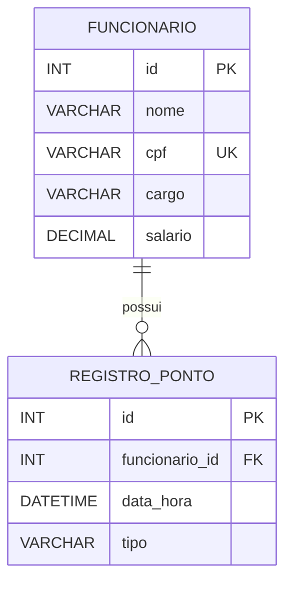

# Controle de Ponto

Sistema de console em **Java** com banco de dados **MySQL** (JDBC) para controle de funcionários e de seus registros de ponto, desenvolvido para a disciplina de **Banco de Dados** (FAESA, 2026/2, Prof. Howard Roatti).

## Integrantes

- Tiago Campos
- Victor Bussular
- Ingrid Junger

## Funcionalidades

O programa abre com uma tela inicial (nome do sistema, integrantes e contagem de registros de cada tabela) e exibe um menu principal que se repete até o usuário escolher sair:

| Opção | O que faz |
|-------|-----------|
| 1 - Consultar registros | Lista funcionários ou registros de ponto |
| 2 - Inserir registros | Cadastra funcionário ou registra ponto (permite inserir vários em sequência) |
| 3 - Remover registros | Exclui funcionário ou registro de ponto, com confirmação |
| 4 - Atualizar registros | Altera funcionário ou registro de ponto (Enter mantém o valor atual) |
| 5 - Relatórios | Relatório com **JOIN** e relatório com **GROUP BY** |
| 0 - Sair | Encerra o programa |

Detalhes do comportamento:

- Inserir, remover e atualizar abrem um submenu para escolher a entidade (**Funcionários** ou **Registros de ponto**). Ao terminar, o sistema pergunta se o usuário quer continuar.
- Ao remover um funcionário que possui registros de ponto, o sistema avisa e pergunta se deseja excluir também os registros vinculados (a exclusão dos dois é feita em uma transação).
- O CPF do funcionário é único; CPF repetido é recusado com mensagem clara.
- Registros de ponto têm tipo `ENTRADA` ou `SAIDA`. Ao inserir, a data/hora pode ser digitada (`dd/MM/aaaa HH:mm`) ou, com Enter, usa o momento atual.
- Relatórios:
  - **JOIN:** funcionários com seus registros de ponto (nome, tipo e data/hora).
  - **GROUP BY:** quantidade de registros de ponto por tipo.

## Modelo de dados

Duas tabelas relacionadas (um funcionário possui vários registros de ponto):



O script de criação está em [`script_controle_ponto.sql`](script_controle_ponto.sql) e o diagrama relacional em [`diagrama_relacional.md`](diagrama_relacional.md).

## Estrutura do projeto

```
ControleDePonto/
├── script_controle_ponto.sql        # criação do banco e das tabelas
├── diagrama_relacional.md           # diagrama relacional
├── PROMPTS.md                       # uso de IA no desenvolvimento
└── src/com/controleponto/
    ├── Main.java                    # tela inicial e menus
    ├── model/                       # Funcionario, RegistroPonto
    ├── controller/                  # FuncionarioController, RegistroPontoController
    ├── reports/                     # Relatorios (JOIN e GROUP BY)
    └── utils/                       # Conexao, Entrada (leitura validada), TesteConexao
```

## Requisitos (Linux)

- **Java JDK 17 ou superior** (`javac` e `java`)
- **MySQL Server 8** (ou compatível) em execução em `localhost:3306`
- **MySQL Connector/J** (driver JDBC, arquivo `.jar`), baixado em <https://dev.mysql.com/downloads/connector/j/> (opção "Platform Independent")

Verifique as versões:

```bash
javac -version
java -version
mysql --version
```

## Como executar

### 1. Clonar o repositório

```bash
git clone https://github.com/vtnnnn7/ControleDePonto.git
cd ControleDePonto
```

### 2. Criar o banco e as tabelas

```bash
sudo mysql < script_controle_ponto.sql
```

O script cria o banco `controle_ponto` com as tabelas `funcionario` e `registro_ponto`.

### 3. Criar o usuário do banco

O programa conecta com o usuário `Vtn` (definido em `src/com/controleponto/utils/Conexao.java`). Crie-o e dê permissão sobre o banco, escolhendo a sua senha:

```bash
sudo mysql -e "CREATE USER IF NOT EXISTS 'Vtn'@'localhost' IDENTIFIED BY 'SUA_SENHA';
               GRANT ALL PRIVILEGES ON controle_ponto.* TO 'Vtn'@'localhost';
               FLUSH PRIVILEGES;"
```

Se preferir outro usuário, altere a constante `USUARIO` em `Conexao.java` antes de compilar.

### 4. Informar a senha por variável de ambiente

A senha **não fica no código**. O programa a lê da variável `DB_SENHA`:

```bash
export DB_SENHA='SUA_SENHA'
```

A variável vale apenas para o terminal atual; defina-a de novo se abrir outro.

### 5. Colocar o driver JDBC no projeto

Copie o `.jar` do Connector/J para uma pasta `lib/` na raiz do projeto (o nome abaixo é um exemplo, use o do arquivo que você baixou):

```bash
mkdir -p lib
cp ~/Downloads/mysql-connector-j-*.jar lib/
```

### 6. Compilar

```bash
mkdir -p bin
javac -cp "lib/*" -d bin $(find src -name "*.java" ! -name module-info.java)
```

O `module-info.java` é usado apenas pelo Eclipse e fica fora da compilação por linha de comando.

### 7. (Opcional) Testar a conexão

```bash
java -cp "bin:lib/*" com.controleponto.utils.TesteConexao
```

A mensagem esperada é `Conexão com MySQL realizada com sucesso!`.

### 8. Executar o sistema

```bash
java -cp "bin:lib/*" com.controleponto.Main
```

## Problemas comuns

| Mensagem | Causa provável | Solução |
|---------------------|----------------|---------|
| `A variavel DB_SENHA nao foi configurada` | `DB_SENHA` não definida neste terminal | Rodar `export DB_SENHA='SUA_SENHA'` |
| `Access denied for user 'Vtn'` | Senha errada ou usuário não criado | Refazer o passo 3 e conferir `DB_SENHA` |
| `Unknown database 'controle_ponto'` | Script SQL não executado | Refazer o passo 2 |
| `No suitable driver found` | `.jar` do Connector/J fora do classpath | Conferir se está em `lib/` e usar `-cp "bin:lib/*"` |
| `Communications link failure` | MySQL parado | `sudo systemctl start mysql` |

## Uso de inteligência artificial

Ferramentas de IA foram usadas como apoio ao desenvolvimento. Os prompts, as fontes e o que o grupo fez com cada resposta estão registrados em [`PROMPTS.md`](PROMPTS.md).

## Vídeo de demonstração

> Adicionar aqui o link do vídeo no YouTube.
